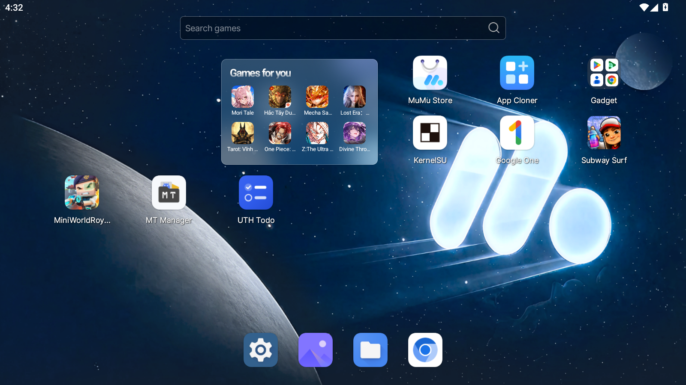
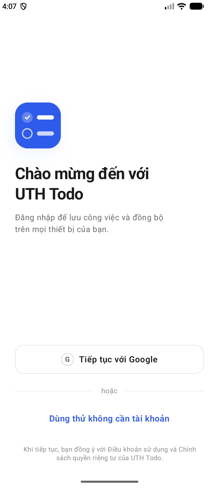
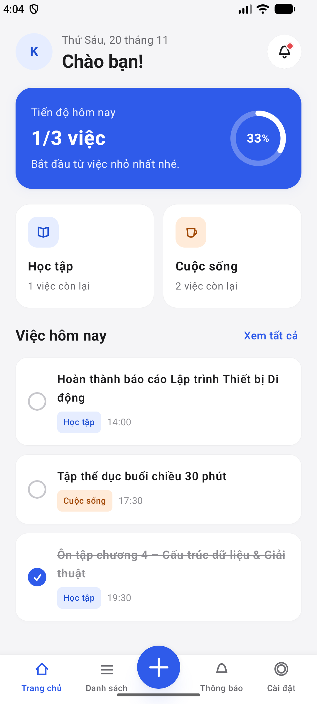
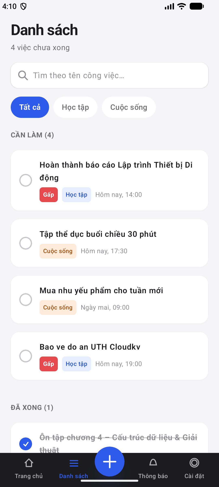
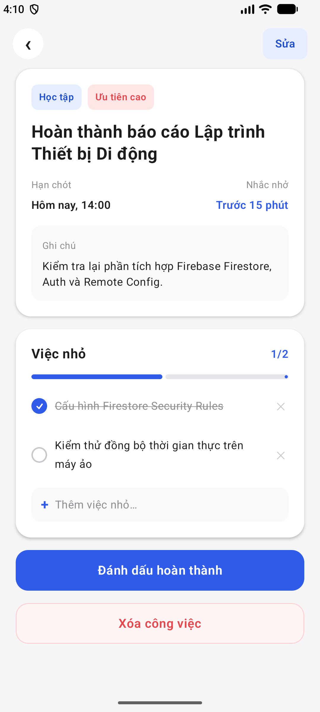
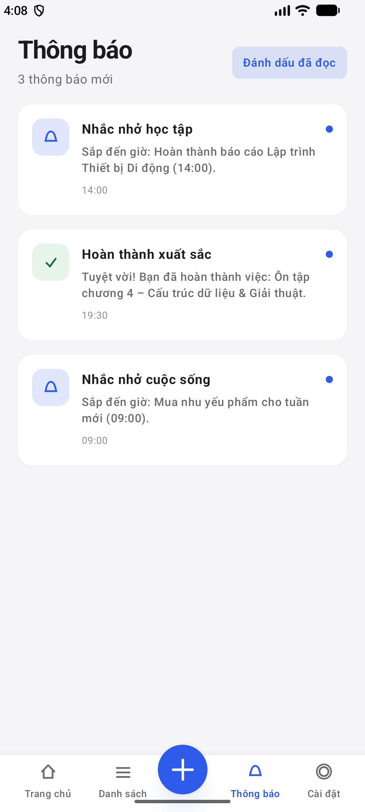
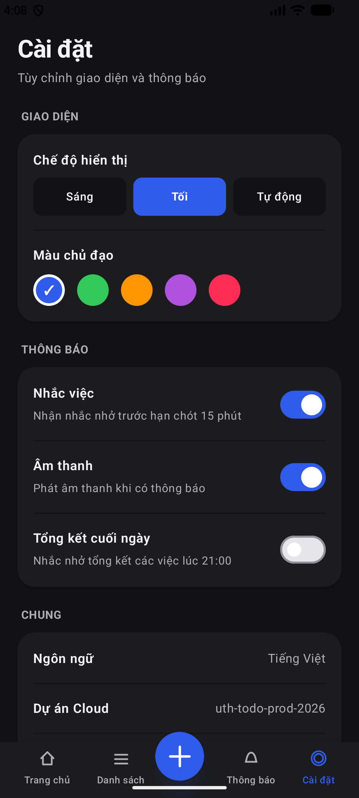
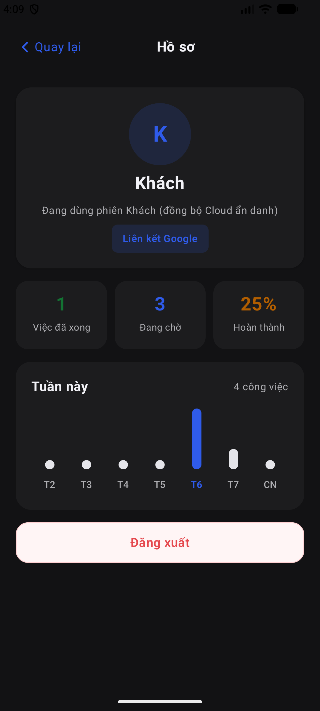
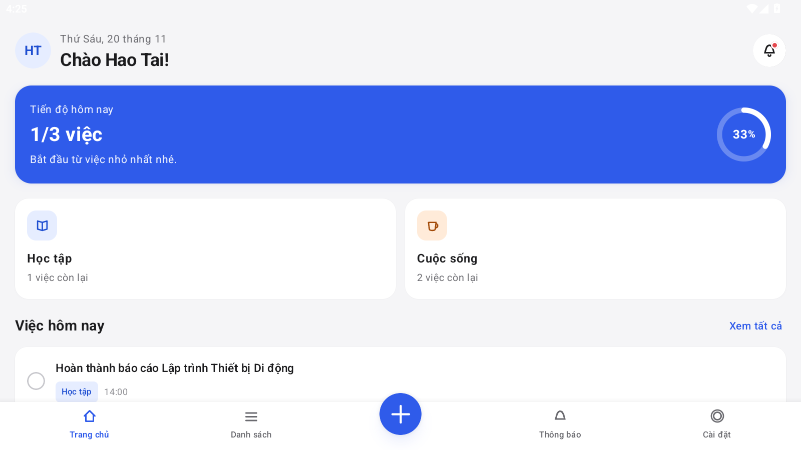

# UTH Todo — Ứng dụng Quản lý Công việc & Học tập (Android Jetpack Compose + Firebase)

Ứng dụng quản lý công việc cá nhân và lịch học tập dành cho sinh viên **UTH (Trường Đại học Giao thông Vận tải TP.HCM)**, được xây dựng hoàn toàn bằng **Kotlin**, **Jetpack Compose (Material 3)** và hệ sinh thái **Google Firebase Production (`uth-todo-prod-2026`)**.

---

## 1. Tính năng nổi bật

- **Khởi động & Cấu hình từ xa (Firebase Remote Config)**:
  - Màn hình chào mừng (`WelcomeScreen`) tự động đồng bộ slogan động (`welcome_slogan`) từ Firebase Remote Config.
  - Luồng giới thiệu 3 bước (`OnboardingScreen`) với đồ họa vector vẽ trực tiếp bằng Compose `Canvas`.
- **Xác thực Đa phương thức (Firebase Authentication & Credential Manager)**:
  - Hỗ trợ **Đăng nhập với Google** (AndroidX `CredentialManager` + Google ID Token + fallback `GoogleSignInClient`).
  - Hỗ trợ **Chế độ Khách (Firebase Anonymous Auth)** và cho phép liên kết nâng cấp tài khoản Khách lên tài khoản Google (`linkWithCredential`) mà không mất dữ liệu.
  - Hỗ trợ **Xóa vĩnh viễn tài khoản & toàn bộ dữ liệu đám mây** ngay trong ứng dụng theo chuẩn chính sách Google Play.
- **Đồng bộ Công việc Thời gian thực (Cloud Firestore + Offline-first Cache)**:
  - Dữ liệu công việc được cô lập an toàn theo từng người dùng tại đường dẫn `/users/{uid}/tasks/task_{id}`.
  - Phân nhóm **Học tập (`study`)** và **Cuộc sống (`life`)**, 3 mức độ ưu tiên (**Thấp**, **Vừa**, **Cao / Gấp**), hạn chót ngày/giờ và danh sách **Việc nhỏ (`Subtasks`)** có thanh tiến độ trực quan.
  - Tìm kiếm tức thì theo tiêu đề/ghi chú và lọc nhanh theo danh mục.
- **Thông báo & Lịch nhắc việc tự động (`AlarmManager` + Firebase Cloud Messaging)**:
  - Tự động đặt lịch thông báo hệ thống nhắc trước hạn chót 15 phút (`ReminderScheduler`).
  - Trung tâm thông báo trong ứng dụng (`NotificationScreen`) tổng hợp việc sắp đến hạn, việc quá hạn và việc đã hoàn thành.
- **Cá nhân hóa Giao diện & Thống kê Hồ sơ**:
  - Chuyển đổi tức thì giữa chế độ **Sáng**, **Tối (Dark Mode)**, **Tự động** và **5 màu chủ đạo** (`#2F5BEA`, `#34C759`, `#FF9500`, `#AF52DE`, `#FF2D55`).
  - Biểu đồ thống kê hoạt động 7 ngày trong tuần (`ProfileScreen`) tính toán trực tiếp từ dữ liệu công việc thực tế.

---

## 2. Hình ảnh Giao diện Thực tế

| Màn hình chính & App Icon | Đăng nhập Google & Khách | Trang chủ (Đồng bộ Firestore) |
| :---: | :---: | :---: |
|  |  |  |

| Danh sách & Bộ lọc | Chi tiết & Việc nhỏ (Subtasks) | Thông báo thông minh |
| :---: | :---: | :---: |
|  |  |  |

| Cài đặt (Chế độ Tối & Màu chủ đạo) | Hồ sơ & Biểu đồ Tuần | Đăng nhập Google trên MuMuPlayer |
| :---: | :---: | :---: |
|  |  |  |

---

## 3. Kiến trúc & Cấu trúc Thư mục

Dự án được tổ chức theo kiến trúc phân tầng rõ ràng (`Clean Layered Package Structure`) trong package `com.uthtodo.dpgh`:

```text
com.uthtodo.dpgh/
├── MainActivity.kt                   # Khởi tạo App, các Manager/Repository & AppNavGraph
├── data/
│   ├── local/
│   │   ├── AppPreferences.kt         # Cài đặt giao diện, màu chủ đạo & thông báo
│   │   └── SessionManager.kt         # Quản lý phiên người dùng
│   ├── model/
│   │   ├── AppNotification.kt        # Model thông báo
│   │   ├── OnboardingModel.kt        # Dữ liệu màn hình giới thiệu
│   │   └── TaskModels.kt             # Model Task, Subtask & chuyển đổi dữ liệu
│   ├── remote/
│   │   ├── FirebaseManager.kt        # Tích hợp dịch vụ Firebase
│   │   └── TaskApiClient.kt          # Client API dữ liệu
│   └── repository/
│       └── TaskRepository.kt         # Đồng bộ dữ liệu Cloud Firestore & local cache
├── service/
│   ├── FCMService.kt                 # Xử lý thông báo đẩy FCM & receiver
│   └── ReminderScheduler.kt          # Lên lịch nhắc việc trước hạn 15 phút
├── ui/
│   ├── components/                   # Bottom bar, Canvas icons, hộp thoại chính sách
│   ├── navigation/
│   │   └── AppNavGraph.kt            # Điều hướng toàn ứng dụng
│   ├── screens/                      # Welcome, Onboarding, Login, Home, TaskList,
│   │                                   # TaskDetail, AddEditTask, Notification, Settings, Profile
│   └── theme/                        # Material 3 Theme, Color, Typography
└── util/
    └── DateTimeUtils.kt              # Định dạng ngày giờ tương đối

---

## 4. Dịch vụ Firebase & Bảo mật (`firestore.rules`)

Dự án tích hợp các dịch vụ Firebase trên project **`uth-todo-prod-2026`**:
1. **Firebase Authentication**: Google Sign-In & Anonymous Auth.
2. **Cloud Firestore**: Cơ sở dữ liệu NoSQL thời gian thực tại region `asia-southeast1`, được bảo vệ bởi [firestore.rules](firestore.rules) kiểm tra quyền sở hữu (`request.auth.uid == userId`), tính bất biến của định danh (`uid`, `id`, `createdAt`) và giới hạn kích thước dữ liệu.
3. **Firebase Remote Config**: Tùy biến thông điệp màn hình khởi động ([remote_config.json](remote_config.json)).
4. **Firebase Cloud Messaging (FCM)**: Nhận thông báo đẩy từ hệ thống.
5. **Firebase Crashlytics & Google Analytics**: Ghi nhận sự kiện người dùng và báo cáo lỗi tự động.

---

## 5. Hướng dẫn Cài đặt & Chạy Dự án

1. **Yêu cầu**:
   - Android Studio Ladybug / Meerkat trở lên (JDK 17 / JBR 21).
   - Thiết bị thật hoặc máy ảo Android (`minSdk = 24`, Android 7.0+).
2. **Biên dịch & Cài đặt bằng dòng lệnh**:
   ```bash
   # Chạy Unit Tests
   ./gradlew testDebugUnitTest

   # Build và cài đặt bản Debug lên thiết bị/máy ảo đang kết nối ADB
   ./gradlew installDebug
   ```
